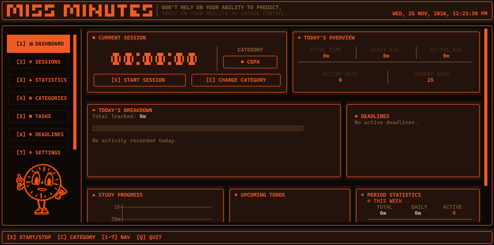

# Time Tracker

A keyboard-driven terminal time tracker built with TypeScript, Bun, SQLite, and OpenTUI Core.

I made one because I have used other apps for a few years now and I realized that I needed some stats and data that I couldn't really get with these apps, so I built one. I always wanted to make my own terminal app, and since TUIs are in fashion, I made one. I might add more features to this as my needs grow, some AI features and integrations are on my mind.

## Preview



## Features

- Start and stop categorized time-tracking sessions.
- Manage categories, tasks, and deadlines from the terminal.
- Review daily, weekly, monthly, and custom-range statistics.
- Compare total time, daily averages, active-day averages, and category shares.
- Inspect bar charts, cumulative progress, time distributions, and calendar summaries.
- Configure locale, time zone, week start, and the logical workday boundary.
- Customize the application title, header text, timer font, and colour theme.
- Adapt the dashboard and management views to narrow and short terminal windows.
- Store all application data locally in SQLite and JSON files.

## Requirements

- [Bun](https://bun.sh/)
- A terminal with true-colour support

## Setup

```sh
git clone <repository-url>
cd time-tracker
bun install
```

The application creates `data/` and its default files on first launch. To begin with the complete example theme catalog instead, copy the provided examples before starting:

```sh
mkdir data
cp settings-example.json data/settings.json
cp themes-example.json data/themes.json
```

PowerShell equivalent:

```powershell
New-Item -ItemType Directory -Force data | Out-Null
Copy-Item settings-example.json data/settings.json
Copy-Item themes-example.json data/themes.json
```

Start the application:

```sh
bun start
```

## Controls

The footer shows the actions available in the active view.

| Key              | Action                                              |
| ---------------- | --------------------------------------------------- |
| `1`–`7`          | Switch views                                        |
| `Q`              | Quit                                                |
| `S`              | Start or stop the active session                    |
| `C`              | Change the dashboard category                       |
| `N`              | Create an item in management views                  |
| `Up` / `Down`    | Change the selected item                            |
| `Space`          | Toggle a task or deadline                           |
| `D`              | Delete the selected item or select daily statistics |
| `R`              | Refresh the active view                             |
| `F`              | Cycle list filters                                  |
| `W` / `M`        | Select weekly or monthly statistics                 |
| `X`              | Enter a custom statistics range                     |
| `Left` / `Right` | Change period or cycle a setting                    |
| `Enter`          | Edit the selected setting                           |

## Configuration

Runtime files live in the ignored `data/` directory:

```text
data/
├── settings.json
├── themes.json
└── time-tracker.sqlite
```

Use [settings-example.json](./settings-example.json) and [themes-example.json](./themes-example.json) as documented starting points. Settings can also be edited from the application's Settings view.

The `workdayStart` setting defines the logical boundary between days. For example, `"02:00"` counts activity between midnight and 02:00 as part of the previous workday. Statistics split sessions at logical day boundaries without changing the stored session records.

## Architecture

The codebase follows a layered design:

```text
OpenTUI views
    ↓
UI controllers
    ↓
Application services
    ↓
Repositories
    ↓
Bun SQLite
```

- **Views** own OpenTUI renderables, responsive layouts, and local input state.
- **Controllers** translate keyboard and form events into application operations.
- **Services** enforce session, category, task, deadline, and statistics rules.
- **Repositories** contain SQLite queries and persistence mappings.
- **Configuration** loads validated JSON settings and theme catalogs.

The UI uses OpenTUI Core directly. Renderables are mutated in place and Yoga handles terminal layout; there is no React reconciliation layer.

## Project structure

```text
src/
├── config/          Settings and theme loading
├── db/              SQLite setup and migrations
├── repositories/    Persistence operations
├── services/        Application and statistics logic
├── types/           Domain and report models
├── ui/              Views, controllers, charts, and components
├── container.ts     Dependency composition
└── index.ts         Application entry point

scripts/
└── seed.ts          Deterministic development dataset

```

## Development

```sh
bun run typecheck
bun run format:check
```

To replace the local database with deterministic demonstration data:

```sh
bun run db:seed
```

The seed command is destructive for the selected database and should only be used for development.

Bun can compile the application into a standalone executable.
